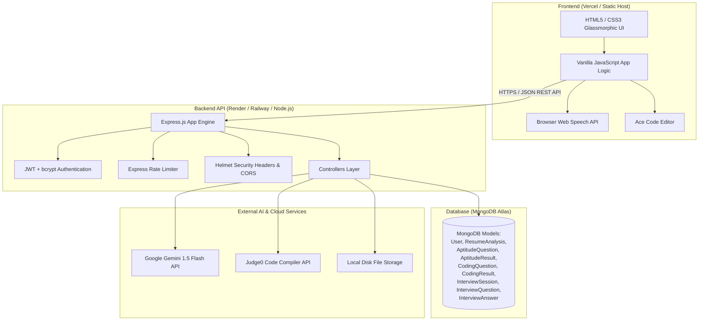

# AI Interview Platform - Production Documentation

A production-ready, full-stack **AI-Powered Candidate Assessment & Interview Platform** built with Vanilla JS, Node.js + Express, MongoDB, Google Gemini AI API, and Judge0 Code Execution API.

---

## 🏗️ System Architecture



---

## 🚀 Environment Setup

### 1. Backend Setup
Navigate to `backend/` and install dependencies:
```bash
cd backend
npm install
```

Create a `.env` file in the `backend/` directory:
```env
PORT=5000
NODE_ENV=development
MONGO_URI=mongodb://localhost:27017/ai_interview_platform
JWT_SECRET=super_secret_jwt_key_here
CLIENT_URL=http://localhost:5500

# AI & External APIs
GEMINI_API_KEY=your_gemini_api_key_here
JUDGE0_API_URL=https://judge0-ce.p.rapidapi.com
JUDGE0_API_KEY=your_judge0_rapidapi_key_here
```

### 2. Seed Mock Questions
Run the seed scripts to populate MongoDB with question banks:
```bash
# Seed Aptitude Question Bank (30 questions)
node seeder.js

# Seed Coding Question Bank (30 challenges)
node codingSeeder.js
```

### 3. Run Backend Server
```bash
npm run dev
```
Backend runs on `http://localhost:5000`.

### 4. Frontend Setup
Simply serve `frontend/` using Live Server or any static web server:
```bash
# Example using npx serve
npx serve frontend
```

---

## 📡 API Documentation

### 🔑 Auth Routes (`/api/auth`)
| Method | Endpoint | Description | Protected |
|---|---|---|---|
| `POST` | `/api/auth/register` | Register a new user account | No |
| `POST` | `/api/auth/login` | Login user & return JWT token | No |

### 👤 User Routes (`/api/user`)
| Method | Endpoint | Description | Protected |
|---|---|---|---|
| `GET` | `/api/user/profile` | Get current user's profile | Yes |
| `PUT` | `/api/user/profile` | Update candidate profile details | Yes |

### 📄 Resume Routes (`/api/resume`)
| Method | Endpoint | Description | Protected |
|---|---|---|---|
| `POST` | `/api/resume/upload` | Upload resume PDF (Max 5MB) | Yes |
| `GET` | `/api/resume` | Fetch active user resume metadata | Yes |
| `DELETE` | `/api/resume` | Delete uploaded resume file | Yes |
| `POST` | `/api/resume/analyze` | Run Gemini AI analysis on uploaded resume | Yes |
| `GET` | `/api/resume/analysis` | Fetch resume analysis results | Yes |

### 🧩 Aptitude Test Routes (`/api/aptitude`)
| Method | Endpoint | Description | Protected |
|---|---|---|---|
| `GET` | `/api/aptitude/start` | Fetch 15 randomized aptitude questions | Yes |
| `POST` | `/api/aptitude/submit` | Grade aptitude assessment submission | Yes |
| `GET` | `/api/aptitude/result` | Get user aptitude test result | Yes |

### 💻 Coding Assessment Routes (`/api/coding`)
| Method | Endpoint | Description | Protected |
|---|---|---|---|
| `GET` | `/api/coding/start` | Fetch 3 coding challenges (Easy, Medium, Hard) | Yes |
| `POST` | `/api/coding/run` | Execute code against sample input via Judge0 | Yes |
| `POST` | `/api/coding/submit` | Grade code against hidden test cases via Judge0 | Yes |
| `GET` | `/api/coding/result` | Get user coding assessment results | Yes |

### 🎙️ AI Interview Routes (`/api/interview`)
| Method | Endpoint | Description | Protected |
|---|---|---|---|
| `POST` | `/api/interview/start` | Generate personalized interview questions via Gemini | Yes |
| `GET` | `/api/interview/question` | Get active question for current interview session | Yes |
| `POST` | `/api/interview/answer` | Submit spoken transcript & grade answer across 5 dimensions | Yes |
| `POST` | `/api/interview/end` | Generate final executive diagnostic report | Yes |
| `GET` | `/api/interview/report` | Fetch latest completed interview report | Yes |

---

## 🌐 Production Deployment Guide

### 1. Database Deployment (MongoDB Atlas)
1. Sign up for a free or paid cluster on [MongoDB Atlas](https://www.mongodb.com/cloud/atlas).
2. Create a database cluster and configure Network Access to allow access from any IP (`0.0.0.0/0`) or specific cloud provider IPs.
3. Create a database user with read/write credentials.
4. Copy the Mongoose Connection String:
   `mongodb+srv://<user>:<password>@cluster0.xxx.mongodb.net/ai_interview_platform?retryWrites=true&w=majority`

### 2. Backend Deployment (Render or Railway)
#### Deploying to Render:
1. Create a Web Service on [Render](https://render.com).
2. Connect your GitHub repository.
3. Set **Root Directory**: `backend`
4. Set **Build Command**: `npm install`
5. Set **Start Command**: `node server.js`
6. Add Environment Variables:
   - `NODE_ENV` = `production`
   - `MONGO_URI` = `<your_atlas_connection_string>`
   - `JWT_SECRET` = `<your_production_secret>`
   - `CLIENT_URL` = `https://your-app.vercel.app`
   - `GEMINI_API_KEY` = `<your_gemini_api_key>`
   - `JUDGE0_API_URL` = `https://judge0-ce.p.rapidapi.com`
   - `JUDGE0_API_KEY` = `<your_rapidapi_key>`

### 3. Frontend Deployment (Vercel)
1. Sign up on [Vercel](https://vercel.com).
2. Import project repository and select `frontend` directory as Root.
3. Keep default static settings (Vercel automatically detects `vercel.json`).
4. Update `frontend/js` API base URLs from `http://localhost:5000` to your deployed backend Render URL (e.g. `https://ai-interview-backend.onrender.com`).
5. Deploy!

---

## 🛡️ Production Security & Quality Checklist

- [x] **Helmet Security Headers**: Configured HTTP response headers to defend against clickjacking, XSS, and MIME-sniffing.
- [x] **Strict CORS Configuration**: Configured CORS origin validation restricting unauthorized cross-domain calls.
- [x] **API Rate Limiting**: Built window rate limiters protecting Judge0 code compilation and global API endpoints.
- [x] **Input Validation & Sanitization**: Enforced validation schemas using Mongoose & Regex.
- [x] **Error Handling Middleware**: Swallowed stack traces in production mode (`NODE_ENV=production`) while serving sanitized JSON errors.
- [x] **Password Protection**: Passwords encrypted using `bcrypt` salts; excluded from default queries (`select: false`).
- [x] **State Obfuscation**: Test answers obfuscated before sending questions to the client side.
